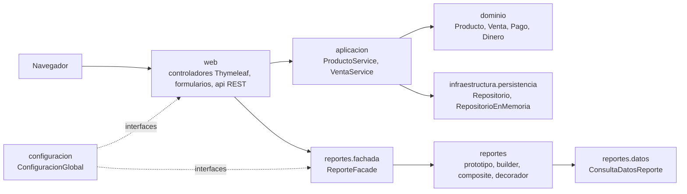

# Gestor de ventas de ferretería

Aplicación web en Java y Spring Boot para una ferretería: inventario de productos, punto de venta con varios métodos de pago y reportes de ventas e inventario. El módulo de reportes está construido con seis patrones de diseño (Singleton, Prototype, Builder, Composite, Decorator y Facade), cada uno en su propio paquete.

Proyecto del curso **Patrones de Diseño de Software** (IDAT). La tienda "Ferretería El Constructor S.A.C." y su RUC son ficticios.

> Estado: las pantallas de productos, ventas y reportes están habilitadas. Al iniciar se cargan productos y ventas de ejemplo en memoria.

## Stack

| Componente | Versión |
|---|---|
| Java (Eclipse Temurin) | 21 |
| Spring Boot (Web MVC, Thymeleaf, Validation) | 4.1.1 |
| Thymeleaf | 3.1 (gestionado por Spring Boot) |
| Bootstrap (copia local en `static/vendor`) | 5.3.3 |
| springdoc-openapi (Swagger UI) | 3.1.1 |
| Maven (incluido con `mvnw`) | 3.9 |
| Pruebas | JUnit, AssertJ, MockMvc |

Los datos se guardan **en memoria**, sin base de datos: se pierden al detener la aplicación (ver [ADR-001](docs/decisiones/ADR-001-persistencia-en-memoria.md)).

## Cómo correrlo

Requisito: JDK 21. No hace falta instalar Maven.

```bash
./mvnw spring-boot:run        # Windows: mvnw.cmd spring-boot:run
```

- Aplicación: http://localhost:8080
- Swagger UI (endpoints `/api`): http://localhost:8080/swagger-ui.html

Pruebas:

```bash
./mvnw verify
```

## Arquitectura



- **dominio**: Java puro, sin Spring. Entidades con id por constructor y sin setters; `Dinero` como objeto de valor.
- **aplicacion**: orquesta casos de uso (por ejemplo, registrar una venta descontando stock en todo o nada).
- **infraestructura.persistencia**: `Repositorio<T>` y su implementación en memoria.
- **reportes**: un subpaquete por patrón; lee datos solo a través de `ConsultaDatosReporte`.
- **web**: pantallas Thymeleaf + Bootstrap; solo conoce `aplicacion` y `ReporteFacade`.

```
src/main/java/pe/idat/ferreteria
├── configuracion/               ConfiguracionGlobal (Singleton) y beans compartidos (Clock America/Lima)
├── dominio/comun/               EntidadBase, Dinero y excepciones del dominio
├── dominio/producto/            productos e inventario
├── dominio/venta/ (pago/)       ventas, líneas y métodos de pago
├── aplicacion/                  servicios de aplicación
├── infraestructura/persistencia Repositorio, RepositorioEnMemoria
├── reportes/
│   ├── modelo/                  Reporte, ReporteBase, TipoReporte, SeccionPlantilla, Periodo, Granularidad
│   ├── datos/                   ConsultaDatosReporte y filas de lectura
│   ├── prototipo/               Prototipo<T> y plantillas
│   ├── builder/                 ReporteBuilder y DirectorReporte
│   ├── composite/               ElementoReporte, Seccion, Parrafo, Tabla, Grafico
│   ├── decorador/               sello, marca de agua, firma simulada
│   └── fachada/                 ReporteFacade, SolicitudReporte, ReporteGenerado
└── web/                         controladores, formularios, manejo de errores, api/
src/main/resources/templates     vistas Thymeleaf y fragmentos del layout
src/main/resources/static        CSS propio y Bootstrap local
src/test/java/...                pruebas con la misma estructura de paquetes
docs/                            decisiones (ADR), UML, capturas y sustentación
```

## Patrones implementados

| Patrón | Dónde | Para qué |
|---|---|---|
| Singleton | `configuracion.ConfiguracionGlobal` | Parámetros únicos de la tienda (razón social, IGV, moneda, formato), expuestos como bean por interfaces |
| Prototype | `reportes.prototipo` | Plantillas de reporte que se clonan en profundidad para derivar variantes |
| Builder | `reportes.builder` | Armar un reporte paso a paso; `DirectorReporte` decide los pasos según la plantilla |
| Composite | `reportes.composite` | Secciones que contienen párrafos, tablas, gráficos u otras secciones, sin límite |
| Decorator | `reportes.decorador` | Agregar sello, marca de agua y firma simulada sin cambiar el reporte base |
| Facade | `reportes.fachada` | Un único método `generarReporte` que oculta todo el flujo anterior |

El diseño detallado de cada patrón (clases, firmas y pruebas) está en [`docs/diseno.md`](docs/diseno.md).

## Equipo y forma de trabajo

Las tareas, responsables y fechas están en los *issues* del repositorio. Los pasos para clonar, crear una rama, hacer commits y abrir un Pull Request están en [`CONTRIBUTING.md`](CONTRIBUTING.md).

## Licencia

[MIT](LICENSE)
